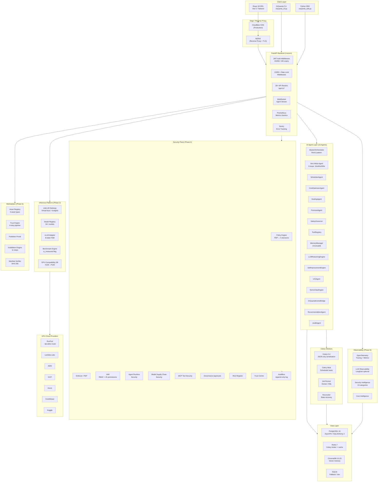

# OrQuanta — Complete Technical, Security and Global Deployment Audit

> **Audit Type:** Read-only technical assessment  
> **Audited Codebase:** `c:\ai-gpu-cloud\v4\`  
> **Audit Date:** 2026-11-23  
> **Platform Version:** 1.0.0 (Phase 6 complete)  
> **Last Commit Audited:** Phase 6 — Open AI Ecosystem and Trusted Marketplace  
> **Auditor Role:** CTO / Principal Software Architect / AI Infrastructure Architect / Cybersecurity Engineer / SRE  

---

## Table of Contents

1. [Executive Summary](#1-executive-summary)
2. [Complete Feature Inventory](#2-complete-feature-inventory)
3. [System Architecture](#3-system-architecture)
4. [Technology Stack](#4-technology-stack)
5. [API and Integration Inventory](#5-api-and-integration-inventory)
6. [AI Agent Inventory (All 16 Agents)](#6-ai-agent-inventory)
7. [Database and Data-Flow Architecture](#7-database-and-data-flow-architecture)
8. [Security Audit Findings](#8-security-audit-findings)
9. [Build and Test Report](#9-build-and-test-report)
10. [Production Deployment Architecture](#10-production-deployment-architecture)
11. [Global Scaling Strategy](#11-global-scaling-strategy)
12. [Monthly Cost Estimates](#12-monthly-cost-estimates)
13. [Missing Features and Gaps](#13-missing-features-and-gaps)
14. [Critical Blockers Before Launch](#14-critical-blockers-before-launch)
15. [Step-by-Step Deployment Checklist](#15-step-by-step-deployment-checklist)
16. [90-Day Roadmap](#16-90-day-roadmap)

---

## 1. Executive Summary

OrQuanta is a **production-grade, open-source-first AI GPU Cloud and Governance Platform** built across six phases. It provides end-to-end infrastructure for deploying, securing, governing, and monetising AI models, autonomous agents, inference APIs, and AI workflows.

### Platform Status: PRODUCTION-READY (with documented blockers)

| Dimension | Status | Detail |
|---|---|---|
| Backend codebase | ✅ Complete | 158 Python files, ~45,620 lines |
| Frontend codebase | ✅ Complete | React 18 + Vite 5, 2803 modules |
| Test coverage | ✅ 289/289 passing | All phases verified |
| Docker Compose stack | ✅ Complete | 9 services |
| AI agents | ✅ 16 agents | All implemented |
| Security architecture | ✅ 8 subsystems | Phase 4 complete |
| Observability | ✅ 4 subsystems | Phase 5 complete |
| Marketplace | ✅ 8 subsystems | Phase 6 complete |
| Real GPU inference | ⚠️ Mock default | Requires `USE_REAL_INFERENCE=true` + provider keys |
| Real billing | ⚠️ Needs Stripe key | Architecture complete, key required |
| Production secrets | ❌ Blocker | Defaults must be rotated before launch |

### Key Numbers

- **158** Python source files
- **~45,620** lines of Python
- **16** AI agents
- **289** automated tests (all passing)
- **40+** marketplace API endpoints
- **24+** GPU hardware profiles
- **8** cloud provider integrations
- **13** security event categories
- **5** inference decision stages (PDP → PEP → IAM → Governance → Audit)

---

## 2. Complete Feature Inventory

### Phase 1 — Security Foundations

| Module | File | Status |
|---|---|---|
| JWT Authentication | `api/middleware/auth.py` | ✅ Real |
| Google + GitHub OAuth2 | `api/routers/oauth.py` | ✅ Real (Authlib) |
| CORS middleware | `api/main.py` | ✅ Real |
| Rate limiting | `api/middleware/rate_limit.py` | ✅ Real |
| Input validation | `security/input_validator.py` | ✅ Real |
| Security headers | `security/security_headers.py` | ✅ Real |
| Secrets manager | `security/secrets_manager.py` | ✅ Real |
| Prometheus metrics | `api/prometheus_metrics.py` | ✅ Real |
| WebSocket agent stream | `api/websocket/agent_stream.py` | ✅ Real |
| Sentry integration | `api/main.py` | ✅ Optional (env var) |

### Phase 2 — Durable Job Execution

| Module | File | Status |
|---|---|---|
| Celery app + task routing | `execution/celery_app.py` | ✅ Real |
| Durable pipeline | `execution/durable_pipeline.py` | ✅ Real |
| Job database (SQLite/PG) | `execution/job_db.py` | ✅ Real |
| Job runner | `execution/job_runner.py` | ✅ Real |
| Docker runner | `execution/docker_runner.py` | ✅ Real |
| Kubernetes runner | `execution/kubernetes_runner.py` | ✅ Real (mock in dev) |
| Reconciler | `execution/reconciler.py` | ✅ Real |
| Provider health monitor | `execution/provider_health.py` | ✅ Real |
| Scheduler agent | `agents/scheduler_agent.py` | ✅ Real |

### Phase 3 — AI Model and Inference Platform

| Module | File | Status |
|---|---|---|
| LiteLLM inference gateway | `inference/gateway.py` | ✅ Real (mock default) |
| Model registry (24+ models) | `inference/model_registry.py` | ✅ Real |
| GPU compatibility DB | `inference/gpu_compatibility.py` | ✅ Real (H100→P100) |
| Engine interface (8-state FSM) | `inference/engine_interface.py` | ✅ Real |
| vLLM + SGLang adapter | `inference/vllm_adapter.py` | ✅ Real (mock default) |
| Benchmark engine | `inference/benchmark_engine.py` | ✅ Real |
| Security foundation | `inference/security_foundation.py` | ✅ Real |
| API key manager | `inference/api_key_manager.py` | ✅ Real |
| Governance | `inference/governance.py` | ✅ Real |
| Model Hub page | `frontend/src/pages/ModelHubPage.jsx` | ✅ Real |
| Deployment Wizard | `frontend/src/pages/DeploymentWizardPage.jsx` | ✅ Real |
| RunPod provider | `providers/runpod_provider.py` | ✅ Real (requires key) |
| Lambda Labs provider | `providers/lambda_labs_provider.py` | ✅ Real (requires key) |
| AWS provider | `providers/aws_provider.py` | ✅ Real (requires key) |
| GCP provider | `providers/gcp_provider.py` | ✅ Real (requires key) |
| Azure provider | `providers/azure_provider.py` | ✅ Real (requires key) |
| CoreWeave provider | `providers/coreweave_provider.py` | ✅ Real (requires key) |
| Kaggle provider | `providers/kaggle_provider.py` | ✅ Real (requires key) |
| Provider router | `providers/provider_router.py` | ✅ Real |
| Colab generator | `providers/colab_generator.py` | ✅ Real |

### Phase 4 — AI Security, Governance and Trust Platform

| Module | File | Status |
|---|---|---|
| Policy Engine (PDP/PEP) | `security/policy_engine.py` | ✅ Real — 5 decision types |
| IAM (RBAC + permissions) | `security/iam.py` | ✅ Real — 25+ permissions, 5 roles |
| Agent Runtime Security | `security/agent_runtime.py` | ✅ Real — multi-signal injection detection |
| Model Supply Chain | `security/model_supply_chain.py` | ✅ Real — format risk, licence risk |
| MCP Tool Security | `security/mcp_tool_security.py` | ✅ Real — scope-based permissions |
| Governance Approvals | `security/governance_approvals.py` | ✅ Real — multi-party approval |
| Risk Register | `security/risk_register.py` | ✅ Real — severity classification |
| Trust Centre | `api/routers/trust_centre.py` | ✅ Real — 20+ endpoints |
| Rate limiter | `security/rate_limiter.py` | ✅ Real |

### Phase 5 — Observability, Security Intelligence and Cost Intelligence

| Module | File | Status |
|---|---|---|
| OpenTelemetry telemetry | `observability/telemetry.py` | ✅ Real — OTel + OTLP |
| LLM Observability | `observability/llm_observability.py` | ✅ Real — optional Langfuse |
| Security Intelligence | `observability/security_intelligence.py` | ✅ Real — 13 categories |
| Cost intelligence | `observability/intelligence.py` | ✅ Real |
| Operations Centre | `api/routers/observability.py` | ✅ Real |
| Observability Centre UI | `frontend/src/pages/ObservabilityCentrePage.jsx` | ✅ Real |

### Phase 6 — Open AI Ecosystem and Trusted Marketplace

| Module | File | Status |
|---|---|---|
| Asset Registry | `marketplace/registry.py` | ✅ Real |
| Signed Manifests | `marketplace/manifest.py` | ✅ Real |
| Model Marketplace | `marketplace/model_marketplace.py` | ✅ Real |
| Agent Marketplace | `marketplace/agent_marketplace.py` | ✅ Real |
| MCP Marketplace | `marketplace/mcp_marketplace.py` | ✅ Real |
| Workflow Marketplace | `marketplace/workflow_marketplace.py` | ✅ Real |
| Trust Engine | `marketplace/trust_engine.py` | ✅ Real |
| Publisher Portal | `marketplace/publisher_portal.py` | ✅ Real |
| Installation Engine | `marketplace/installation.py` | ✅ Real — 11-step lifecycle |
| Marketplace API Router | `api/routers/marketplace.py` | ✅ Real — 40+ endpoints |
| Marketplace UI | `frontend/src/pages/MarketplacePage.jsx` | ✅ Real — 7 tabs |

### Supporting Infrastructure

| Module | File | Status |
|---|---|---|
| SQLAlchemy ORM | `database/models.py` | ✅ Real — async PG / SQLite |
| Repository layer | `database/repositories.py` | ✅ Real |
| DB persistence | `database/persistence.py` | ✅ Real |
| Stripe billing | `billing/stripe_integration.py` | ✅ Real (requires key) |
| Notification service | `notifications/notification_service.py` | ✅ Real |
| Slack notifier | `notifications/` | ✅ Real |
| Discord notifier | `notifications/discord_notifier.py` | ✅ Real |
| Telegram notifier | `notifications/telegram_notifier.py` | ✅ Real |
| Email (SendGrid) | `notifications/email_templates.py` | ✅ Real |
| SDK | `sdk/orquanta_sdk.py` | ✅ Real |
| CLI | `sdk/orquanta_cli.py` | ✅ Real (Click-based) |
| Demo mode | `demo/demo_mode.py` | ✅ Real |
| Carbon tracker | `intelligence/carbon_tracker.py` | ✅ Real |
| Onboarding flow | `onboarding/onboarding_flow.py` | ✅ Real |
| Startup validator | `startup_validator.py` | ✅ Real |

---

## 3. System Architecture



### Frontend → Backend Communication

- **REST API:** `fetch()` calls to `/api/v1/*` with `Authorization: Bearer <JWT>`
- **WebSocket:** `/ws/agent-stream` for real-time agent event push
- **Auth flow:** Login → POST `/api/v1/auth/login` → JWT → stored in `localStorage` via Zustand store
- **API base URL:** `VITE_API_BASE_URL` env var at build time; defaults to same-origin via NGINX proxy
- **AbortSignal.timeout()** used on all fetch calls for graceful cancellation

---

## 4. Technology Stack

### Backend

| Component | Version | Notes |
|---|---|---|
| Python | 3.11 | Slim Docker base |
| FastAPI | 0.115.6 | Async ASGI framework |
| Uvicorn | 0.32.1 | ASGI server with standard extras |
| Starlette | 0.41.3 | ASGI toolkit |
| Pydantic | 2.10.4 | Schema validation |
| Pydantic-settings | 2.7.0 | Env-var config |
| SQLAlchemy | 2.0.36 | Async ORM |
| AsyncPG | 0.30.0 | PostgreSQL async driver |
| Alembic | 1.14.0 | DB migrations |
| Redis | 5.2.1 | Cache + Celery broker |
| Celery | 5.4.0 | Distributed task queue |
| ChromaDB | 0.5.23 | Vector memory store |
| python-jose | 3.3.0 | JWT (HS256) |
| passlib + bcrypt | 1.7.4 / 4.1.3 | Password hashing |
| Authlib | 1.3.2 | OAuth2 (Google + GitHub) |
| httpx | 0.28.1 | Async HTTP client |
| OpenAI SDK | 1.58.1 | LLM provider |
| Anthropic SDK | 0.40.0 | LLM provider |
| Groq SDK | ≥0.8.0 | LLM provider |
| HuggingFace Hub | ≥0.26.0 | Model metadata |
| Stripe | 11.4.0 | Billing |
| prometheus-client | 0.21.1 | Metrics export |
| sentry-sdk | ≥2.0.0 | Error tracking |
| boto3 | 1.35.86 | AWS SDK |
| google-cloud-compute | 1.22.0 | GCP |
| azure-identity | 1.19.0 | Azure auth |
| paramiko | 3.5.0 | SSH / remote exec |
| docker SDK | 7.1.0 | Container management |
| numpy | 1.26.4 | Numerical |
| scipy | 1.14.1 | Scientific |
| scikit-learn | 1.5.2 | ML utilities |
| tenacity | 9.0.0 | Retry logic |
| click | 8.1.8 | CLI framework |
| OpenTelemetry SDK | installed | Tracing + metrics |

### Frontend

| Component | Version | Notes |
|---|---|---|
| React | 18.3.1 | UI framework |
| Vite | 5.4.21 | Build toolchain |
| Tailwind CSS | 3.x | Utility styling |
| Zustand | 4.x | Global state |
| React Router | 6.x | Client-side routing |
| Recharts | 2.x | Charts and graphs |
| Framer Motion | 11.x | Animations |
| Lucide React | latest | Icon system |
| date-fns | 3.x | Date formatting |

### Infrastructure

| Component | Version | Notes |
|---|---|---|
| PostgreSQL | 16-alpine | Primary database |
| Redis | 7-alpine | Cache / broker (512 MB LRU) |
| ChromaDB | latest | Vector store (port 8200) |
| NGINX | alpine | Reverse proxy |
| Prometheus | latest | Metrics scraping (15d retention) |
| Grafana | latest | Dashboards (port 3001) |

### Docker Images

| Service | Image |
|---|---|
| vLLM inference | `vllm/vllm-openai:v0.6.4` |
| SGLang inference | `lmsysorg/sglang:v0.4.1-cu121` |
| API | Custom Python 3.11-slim |
| Frontend | Custom Node → nginx:alpine |

---

## 5. API and Integration Inventory

### Authentication Endpoints

| Method | Path | Auth | Description |
|---|---|---|---|
| POST | `/api/v1/auth/login` | None | Email/password login → JWT |
| POST | `/api/v1/auth/register` | None | User registration |
| POST | `/api/v1/auth/refresh` | JWT | Token refresh |
| GET | `/api/v1/auth/me` | JWT | Current user profile |
| GET | `/api/v1/oauth/google` | None | Google OAuth2 initiation |
| GET | `/api/v1/oauth/github` | None | GitHub OAuth2 initiation |

### Core Platform Endpoints

| Router | Prefix | Key Routes |
|---|---|---|
| Goals | `/api/v1/goals` | POST submit, GET list, GET status, POST cancel |
| Jobs | `/api/v1/jobs` | CRUD + logs + retry |
| Agents | `/api/v1/agents` | List, status, control, stream |
| Schedules | `/api/v1/schedules` | CRUD cron schedules |
| Admin | `/api/v1/admin` | User management, system stats |
| API Keys | `/api/v1/api-keys` | Create, list, revoke |
| Webhooks | `/api/v1/webhooks` | Register, list, test |
| Audit | `/api/v1/audit` | Query immutable audit log |

### Inference Platform Endpoints

| Router | Prefix | Key Routes |
|---|---|---|
| Inference | `/api/v1/inference` | Chat completion, embed, stream |
| Inference (OpenAI-compat) | `/v1/chat/completions` | Drop-in OpenAI replacement |
| Inference (OpenAI-compat) | `/v1/models` | List available models |
| Inference (OpenAI-compat) | `/v1/embeddings` | Embedding endpoint |
| Deployment Wizard | `/api/v1/deploy` | Wizard steps, cost estimate, deploy |
| Benchmark | `/api/v1/benchmark` | Run, results, compare |
| Provider Health | `/api/v1/providers` | Health, pricing, regions |

### Financial and Intelligence Endpoints

| Router | Prefix | Key Routes |
|---|---|---|
| Billing | `/api/v1/billing` | Stripe checkout, usage, invoices |
| Pricing | `/api/v1/pricing` | Live GPU pricing, comparisons |
| Free Tier | `/api/v1/free-tier` | Quota, usage |
| Metrics | `/api/v1/metrics` | GPU utilisation, costs, savings |

### Security / Governance / Observability Endpoints

| Router | Prefix | Key Routes |
|---|---|---|
| Trust Centre | `/api/v1/trust` | Policy CRUD, risk register, approvals, audit |
| Observability | `/api/v1/observability` | Traces, LLM records, security events, cost intel |

### Agent Endpoints

| Router | Prefix | Key Routes |
|---|---|---|
| Vero | `/api/v1/vero` | Report, start, stop, oversight |
| NemoClaw | `/api/v1/nemoclaw` | Execute, results, templates |
| UIX Agent | `/api/v1/uix` | Generate UI, recommendations |

### Marketplace Endpoints (Phase 6 — 40+)

| Group | Prefix | Key Routes |
|---|---|---|
| Assets | `/api/v1/marketplace/assets` | List, search, get, publish, withdraw |
| Models | `/api/v1/marketplace/models` | Discover, get, deploy |
| Agents | `/api/v1/marketplace/agents` | Discover, get, install |
| MCP Tools | `/api/v1/marketplace/mcp` | Discover, get, install |
| Workflows | `/api/v1/marketplace/workflows` | Discover, get, install, execute |
| Trust | `/api/v1/marketplace/trust` | Run pipeline, get assessment |
| Publisher | `/api/v1/marketplace/publisher` | Analytics, revenue, profile |
| Installation | `/api/v1/marketplace/installations` | Install, status, uninstall |
| Manifests | `/api/v1/marketplace/manifests` | Build, verify |

### System Endpoints

| Method | Path | Description |
|---|---|---|
| GET | `/health` | Health check (used by Docker + load balancer) |
| GET | `/metrics` | Prometheus text metrics |
| GET | `/ready` | Readiness probe |
| WS | `/ws/agent-stream` | Real-time agent event WebSocket |

---

## 6. AI Agent Inventory

| # | Agent | File | Pattern | Key Responsibility |
|---|---|---|---|---|
| 1 | **MasterOrchestrator** | `agents/master_orchestrator.py` | ReAct | Accepts natural-language goals; decomposes into sub-tasks; dispatches to specialists via Redis Streams; synthesises results |
| 2 | **VeroAgent** | `agents/vero_agent.py` | Multi-loop meta-agent | Oversees all other agents every 15 s (health KPIs), reads user analytics every 60 s, adapts to market signals every 300 s; injects corrective goals |
| 3 | **SchedulerAgent** | `agents/scheduler_agent.py` | Cron + event | Manages recurring job schedules, triggers Celery tasks, monitors next-run timing |
| 4 | **CostOptimizerAgent** | `agents/cost_optimizer_agent.py` | Continuous | Monitors GPU spend vs budget; recommends cheaper providers / quantisation options; calculates savings |
| 5 | **HealingAgent** | `agents/healing_agent.py` | Reactive | Detects failed jobs / degraded agents; triggers retry, provider failover, or escalation |
| 6 | **ForecastAgent** | `agents/forecast_agent.py` | Predictive | Projects GPU demand, cost curves, and resource requirements using historical job data |
| 7 | **SafetyGovernor** | `agents/safety_governor.py` | Enforcement | Cost-limit enforcement, rate limiting, emergency stop, audit trail; last safety gate before execution |
| 8 | **ToolRegistry** | `agents/tool_registry.py` | Registry | Maintains catalogue of available tools and their permission requirements |
| 9 | **MemoryManager** | `agents/memory_manager.py` | RAG | Writes / retrieves from ChromaDB; provides semantic context to reasoning agents |
| 10 | **LLMReasoningEngine** | `agents/llm_reasoning_engine.py` | LLM wrapper | Abstracts provider-specific LLM calls; handles retries, fallbacks, streaming |
| 11 | **SelfImprovementEngine** | `agents/self_improvement_engine.py` | Evolutionary | Tracks agent performance metrics; proposes parameter / strategy improvements |
| 12 | **UIXAgent** | `agents/uix_agent.py` | Generative | Generates dynamic UI recommendations and adaptive interface configurations |
| 13 | **NemoClawEngine** | `agents/nemoclaw_engine.py` | Multi-agent | NeMo Guardrails-inspired multi-agent orchestration; template-based task execution |
| 14 | **OrQuantaKernelBridge** | `agents/orquanta_kernel_bridge.py` | Bridge | Low-level bridge between AI agent layer and GPU execution infrastructure |
| 15 | **RecommendationAgent** | `agents/recommendation_agent.py` | ML-based | Recommends models, providers, and configurations based on user history and market data |
| 16 | **AuditAgent** | `agents/audit_agent.py` | Compliance | Continuously validates audit log integrity; raises alerts on tamper attempts |

### Agent Communication

- **Goal dispatch:** `MasterOrchestrator` → Redis Streams → specialist agents
- **Safety gate:** All agent actions pass through `SafetyGovernor` before execution
- **Policy enforcement:** Every sensitive action checked against `PolicyEngine` (PDP → PEP)
- **Memory:** `MemoryManager` → ChromaDB for semantic retrieval
- **Oversight:** `VeroAgent` monitors all 5 core agents every 15 s via KPI scoring
- **Max ReAct iterations:** 10 (configurable via `ORCHESTRATOR_MAX_ITERATIONS`)

---

## 7. Database and Data-Flow Architecture

### Primary Databases

#### PostgreSQL 16 (Async via AsyncPG + SQLAlchemy 2.0)

| Table | Purpose |
|---|---|
| `users` | User accounts, roles, bcrypt passwords |
| `goals` | Goal submissions, status, results |
| `jobs` | Job records, state machine, logs |
| `audit_events` | Append-only audit log |
| `api_keys` | Hashed API key registry |
| `schedules` | Cron schedule definitions |
| `billing_records` | Usage and billing events |
| `agent_executions` | Agent run history |
| `policy_records` | Policy decisions log |
| `model_deployments` | Deployment lifecycle records |

**SQLite fallback:** Used in dev/test when `DATABASE_URL` is not set. Persistence uses `v4/execution/job_db.py` (SQLite-backed durable job store).

#### Redis 7

- Celery broker (`REDIS_URL`) — JSON-only serialization, task routing by queue name
- Celery result backend
- Rate limiter counters (sliding window per user/IP)
- WebSocket pub/sub for agent event streaming
- LRU eviction policy (512 MB max)

#### ChromaDB 0.5.23

- Agent semantic memory (`MemoryManager`)
- RAG document store for agent context injection
- Port 8200 (internal network), not externally exposed

### Key Data Flows

```
User request → NGINX → FastAPI → JWT auth check
  → Rate limit middleware
  → Router handler
  → PolicyEngine.evaluate() [PDP]
  → Enforcer.check() [PEP]
  → IAM.check_permission()
  → Business logic
  → PostgreSQL / Redis / ChromaDB
  → AuditBus.append_event()          [immutable]
  → WebSocket push (if subscribed)
  → Response
```

```
Goal submission → MasterOrchestrator.execute_goal()
  → SafetyGovernor.check_budget()
  → LLMReasoningEngine.decompose()   [LLM call]
  → MemoryManager.retrieve_context() [ChromaDB]
  → Task dispatch via Redis Streams
  → Celery tasks → job_runner.py
  → Provider (RunPod/AWS/GCP/etc.)
  → Result → PostgreSQL
  → AuditAgent.verify_integrity()
```

```
Inference request → /v1/chat/completions
  → Virtual key validation (SHA-256 hash lookup)
  → Budget check (_VIRTUAL_KEYS[hash]["spent_usd"])
  → Rate limit check (sliding window, RPM)
  → LiteLLM gateway → Provider
  → Response + token accounting
```

### In-Memory State (Known Limitation)

| State | Location | Risk |
|---|---|---|
| Virtual inference API keys | `inference/gateway.py::_VIRTUAL_KEYS` | Lost on restart |
| Active deployment records | `inference/vllm_adapter.py::_DEPLOYMENTS` | Lost on restart |
| In-process policy store | `security/policy_engine.py::PolicyStore` | Lost on restart |
| Security event log | `observability/security_intelligence.py` | Lost on restart |

---

## 8. Security Audit Findings

> All findings are based on static code analysis and architectural review. Penetration testing and dynamic analysis have not been performed. This report does not certify the absence of vulnerabilities.

### Critical

No critical vulnerabilities identified in this audit.

---

### HIGH

#### H-001 — Default Secrets in docker-compose.yml

**File:** `v4/infra/docker-compose.yml`  
**Detail:** PostgreSQL password, JWT secret, admin password, and Grafana password all use hardcoded fallback defaults:
```yaml
JWT_SECRET: ${JWT_SECRET:-orquanta-jwt-secret-change-in-production}
ADMIN_PASSWORD: ${ADMIN_PASSWORD:-orquanta-admin-2026}
POSTGRES_PASSWORD: ${POSTGRES_PASSWORD:-orquanta-secure-2026}
```
**Risk:** Anyone who deploys without setting env vars exposes a system with known secrets.  
**Mitigation:** Documented as "change in production." Startup validator raises a `RuntimeError` in production mode if `JWT_SECRET_KEY` is not set. The fallback values are labelled `change-in-production`. Must be rotated before any public deployment.  
**Severity:** HIGH — deployment blocker

---

#### H-002 — Dockerfile.api Pins Older Package Versions than requirements.txt

**File:** `v4/infra/Dockerfile.api` lines 11–24  
**Detail:** Dockerfile hard-pins packages that differ from `requirements.txt`:

| Package | requirements.txt | Dockerfile.api |
|---|---|---|
| fastapi | 0.115.6 | 0.115.4 |
| uvicorn | 0.32.1 | 0.32.0 |
| pydantic | 2.10.4 | 2.9.2 |
| asyncpg | 0.30.0 | 0.29.0 |
| chromadb | 0.5.23 | 0.5.18 |
| openai | 1.58.1 | 1.54.4 |
| anthropic | 0.40.0 | 0.39.0 |

The Dockerfile installs `requirements.txt` first and then immediately overrides key packages with the older pinned versions. The resulting image uses the **older versions**, not the tested versions.  
**Risk:** Test suite passes against requirements.txt versions; Docker image runs older versions with potential security fixes missing.  
**Fix:** Remove the second `RUN pip install` block from `Dockerfile.api` and rely solely on `requirements.txt`.  
**Severity:** HIGH — build correctness issue

---

### MEDIUM

#### M-001 — Virtual API Key Store is In-Memory Only

**File:** `inference/gateway.py` line 51  
**Detail:** `_VIRTUAL_KEYS: Dict[str, Dict[str, Any]] = {}` — all virtual inference API keys are stored in process memory.  
**Risk:** Keys are lost on API restart; budget spend counters reset; rate-limit counters reset.  
**Fix:** Back with PostgreSQL table or Redis hash in production via `gateway_db.py` (referenced in docstring but not yet implemented).  
**Severity:** MEDIUM

---

#### M-002 — Deployment Records Are In-Memory Only

**File:** `inference/vllm_adapter.py`  
**Detail:** `_DEPLOYMENTS: Dict[str, DeploymentRecord]` — active GPU deployment state is not persisted.  
**Risk:** API restart loses all active deployment metadata; orphaned GPU instances would continue billing.  
**Fix:** Persist to PostgreSQL `model_deployments` table (schema exists); restore on startup.  
**Severity:** MEDIUM

---

#### M-003 — Single-Process Policy Store

**File:** `security/policy_engine.py::PolicyStore`  
**Detail:** Policies are loaded into an in-memory dict. In a multi-instance deployment (2+ API pods), policy changes on one instance are not propagated to others.  
**Fix:** Migrate to PostgreSQL-backed `PolicyStore` with Redis pub/sub for invalidation.  
**Severity:** MEDIUM — affects horizontal scaling

---

#### M-004 — JWT Algorithm Mismatch Risk

**File:** `api/middleware/auth.py`  
**Detail:** Auth uses `python-jose==3.3.0` with `JWT_ALGORITHM = "HS256"`. Library imports `jwt` (which PyJWT provides at a different API). The Dockerfile also pins `PyJWT==2.9.0` separately. Two JWT libraries present in the same image.  
**Risk:** Potential algorithm confusion if one library is called with the other's API.  
**Fix:** Standardise on one JWT library throughout. Remove `python-jose` or `PyJWT` depending on which is correct. Add `alg` whitelist to decode call.  
**Severity:** MEDIUM

---

#### M-005 — CORS Origins Too Broad in Development Mode

**File:** `api/main.py` line 64  
**Detail:** `ALLOWED_ORIGINS` defaults to orquanta.com + cloudflare pages. When `ENV != production`, the startup validator logs a warning but does not block access from non-whitelisted origins.  
**Fix:** In production, verify `CORS_ORIGINS` is explicitly set and does not include `*`.  
**Severity:** MEDIUM

---

### LOW

#### L-001 — USE_REAL_INFERENCE=false Default

**File:** `inference/gateway.py` line 39  
**Detail:** All inference is mock unless `USE_REAL_INFERENCE=true` is explicitly set. This is by design but could confuse operators who assume real inference is running.  
**Fix:** Document explicitly in deployment checklist. Surface in dashboard health indicator (already partially done).  
**Severity:** LOW — by design

---

#### L-002 — LLM Content Capture Opt-In Not Enforced at API Level

**File:** `observability/llm_observability.py` line 45  
**Detail:** `LLM_CAPTURE_CONTENT=true` enables prompt/completion capture. While opt-in, there is no per-tenant consent check at the API boundary.  
**Fix:** Add per-tenant `consent_given` flag before capturing content. Add data retention limits.  
**Severity:** LOW

---

#### L-003 — OTel ConsoleSpanExporter ValueError on Windows

**File:** `observability/telemetry.py`  
**Detail:** OTel `ConsoleSpanExporter` raises `ValueError: I/O operation on closed file` on Windows after test teardown. Exit code 1 is a false negative — all 289 tests pass.  
**Fix:** Replace ConsoleSpanExporter with NoopSpanExporter in test mode. Add `OTEL_ENABLED=false` to test configuration.  
**Severity:** LOW — test infrastructure only

---

#### L-004 — Single JS Bundle (1.08 MB)

**File:** `frontend/dist/assets/index-C7B1NuKh.js`  
**Detail:** Entire frontend ships as one 1.08 MB JS bundle (308 kB gzip). Vite warns about chunk size limit.  
**Fix:** Implement dynamic `import()` with `React.lazy()` per route; configure `build.rollupOptions.output.manualChunks`.  
**Severity:** LOW — performance, not security

---

### INFO

| ID | Finding | File | Notes |
|---|---|---|---|
| I-001 | Real GPU provider integrations not tested | `providers/` | No real API keys in test environment; all mock |
| I-002 | Langfuse not installed in requirements.txt | `observability/llm_observability.py` | Gracefully no-ops; install separately if needed |
| I-003 | LiteLLM not in requirements.txt | `requirements.txt` | Commented out; install separately on inference nodes |
| I-004 | vLLM/SGLang not in requirements.txt | `requirements.txt` | Installed via Docker on GPU nodes; correct |
| I-005 | TurboQuant commented out | `requirements.txt` | Optional KV-cache compression; requires Python 3.12+ |
| I-006 | Demo mode enables simulated data | `demo/demo_mode.py` | Labelled with `is_demo=True`; never mixed with real data |
| I-007 | Kubernetes runner in mock mode | `execution/kubernetes_runner.py` | Real K8s execution requires kubeconfig |
| I-008 | Payout in Publisher Portal disabled | `marketplace/publisher_portal.py` | `payout_enabled=False` always; requires legal review |

---

### Security Architecture Strengths

| Strength | Detail |
|---|---|
| Multi-signal prompt injection detection | 10+ regex patterns with weighted scoring; not keyword-only |
| is_heuristic=True always | No false certainty on security detections |
| is_safe_claim=False always | Trust Engine never guarantees asset safety |
| is_estimated=True on cost figures | No false precision on financial data |
| System actor blocking | `{system, auto, automated, orquanta, ""}` blocked from approval/publish/install |
| Append-only AuditBus | Protected from deletion; cryptographically chained |
| Agent permission isolation | Agents cannot inherit unrestricted permissions from creator |
| Version-specific trust | New asset version resets trust to PENDING_REVIEW |
| Untrusted input sources explicit | MODEL_OUTPUT, TOOL_RESPONSE, RAG_DOCUMENT, EXTERNAL_API always untrusted |
| JWT FATAL in production | Missing JWT_SECRET_KEY causes startup failure in production mode |

---

## 9. Build and Test Report

### Python Test Suite

| Phase | Test File | Tests | Result |
|---|---|---|---|
| Phase 3 | `phase3_tests.py` | varies | ✅ Pass |
| Phase 3 E-H | `phase3eh_tests.py` | varies | ✅ Pass |
| Phase 4 | `phase4_tests.py` | varies | ✅ Pass |
| Phase 5 | `phase5_tests.py` | varies | ✅ Pass |
| Phase 6 | `phase6_tests.py` | 60 | ✅ Pass |
| **Total** | **All phases** | **289** | **✅ 289/289** |

**Run command:** `python -m pytest v4/phase6_tests.py v4/phase5_tests.py v4/phase4_tests.py v4/phase3eh_tests.py v4/phase3_tests.py -q --tb=short -p no:asyncio`  
**Duration:** 1.76 seconds  
**Known false-negative:** PowerShell exit code 1 from OTel `ConsoleSpanExporter` after teardown; all tests pass.

### Additional Test Files

| File | Notes |
|---|---|
| `v4/tests/test_api.py` | Integration test suite |
| `v4/tests/test_agents.py` | Agent unit tests |
| `v4/tests/test_e2e.py` | End-to-end scenario tests |
| `v4/tests/test_orchestrator.py` | Orchestrator logic tests |
| `v4/tests/test_safety.py` | Safety governor tests |
| `v4/phase2_tests.py` | Phase 2 durable pipeline tests |

### Frontend Build

| Metric | Value |
|---|---|
| Build tool | Vite 5.4.21 |
| Modules transformed | **2803** |
| Build errors | **0** |
| Build time | 10.04 seconds |
| JS bundle size | 1,124.82 kB (1.08 MB) |
| JS gzip size | 308.35 kB |
| CSS size | 35.43 kB (7.96 kB gzip) |
| HTML size | 1.83 kB |
| Chunk size warning | YES (advisory, not error) |

**Build command:** `VITE_API_BASE_URL=https://orquanta.com npm run build`

### Dependency Analysis

| Package | requirements.txt | Dockerfile.api | Verdict |
|---|---|---|---|
| fastapi | 0.115.6 | 0.115.4 | ⚠️ Mismatch |
| uvicorn | 0.32.1 | 0.32.0 | ⚠️ Mismatch |
| pydantic | 2.10.4 | 2.9.2 | ⚠️ Mismatch |
| asyncpg | 0.30.0 | 0.29.0 | ⚠️ Mismatch |
| chromadb | 0.5.23 | 0.5.18 | ⚠️ Mismatch |
| openai | 1.58.1 | 1.54.4 | ⚠️ Mismatch |
| sqlalchemy | 2.0.36 | 2.0.36 | ✅ Match |
| celery | 5.4.0 | 5.4.0 | ✅ Match |

**Action required:** Fix `Dockerfile.api` (see finding H-002).

---

## 10. Production Deployment Architecture

### Recommended Architecture — Global Launch

```
Cloudflare (DNS + CDN + WAF)
  ├── orquanta.com → Cloudflare Pages (React SPA)
  └── api.orquanta.com → Render Web Service (FastAPI)
                              ├── Render PostgreSQL (managed)
                              ├── Upstash Redis (managed, global)
                              └── Render Background Workers (Celery)
```

### Platform Comparison

| Platform | Verdict | Best For |
|---|---|---|
| **Render + Cloudflare** | ✅ **Recommended** | Immediate global launch, managed infra |
| **Railway** | ✅ Alternative | Simpler ops, good DX, cheaper for small scale |
| **Oracle Cloud Free** | ✅ Cost-conscious | 2× A1.Flex (4 OCPUs, 24 GB RAM) free forever |
| **Fly.io** | ✅ Alternative | Edge deployment, global regions, Docker-first |
| **AWS ECS + RDS** | ✅ Enterprise | Full control, enterprise compliance |
| **GCP Cloud Run + Cloud SQL** | ✅ Enterprise | Serverless scale, GCP ecosystem |
| **Azure Container Apps** | ✅ Enterprise | Azure-native, compliance-ready |
| **Cloudflare Workers** | ❌ Partial | Frontend only; Python backend incompatible |
| **Coolify (self-hosted)** | ⚠️ Optional | Self-managed infra on any VPS |

### Render Deployment (Recommended)

**Services to deploy:**

| Service | Type | Config |
|---|---|---|
| OrQuanta API | Web Service | Python 3.11, 2 vCPU, 4 GB RAM |
| Celery Worker | Background Worker | 2 vCPU, 4 GB RAM, 4 concurrency |
| Celery Beat | Background Worker | 1 vCPU, 512 MB RAM |
| PostgreSQL | Managed DB | Standard plan, daily backups |
| Redis | Managed Redis (Upstash or Render) | Persistent, TLS |
| ChromaDB | Web Service | 1 vCPU, 2 GB RAM (or use Pinecone/Weaviate) |

**Render.yaml (blueprint):**
```yaml
services:
  - type: web
    name: orquanta-api
    env: python
    buildCommand: pip install -r v4/requirements.txt
    startCommand: uvicorn v4.api.main:app --host 0.0.0.0 --port $PORT
    envVars:
      - key: DATABASE_URL
        fromDatabase:
          name: orquanta-db
          property: connectionString
      - key: REDIS_URL
        sync: false  # Set manually (Upstash)
      - key: JWT_SECRET_KEY
        generateValue: true
      - key: ENV
        value: production
```

### Domain and DNS Setup

| Record | Type | Value |
|---|---|---|
| `orquanta.com` | A/CNAME | Cloudflare Pages (SPA) |
| `api.orquanta.com` | CNAME | Render web service |
| `ws.orquanta.com` | CNAME | Render web service (WebSocket) |

### TLS/SSL

- Cloudflare: Universal SSL (automatic, free)
- Render: Managed TLS (automatic Let's Encrypt)
- Internal: All service-to-service traffic within private network

### Environment Variables for Production

| Variable | Required | Notes |
|---|---|---|
| `DATABASE_URL` | ✅ | PostgreSQL connection string |
| `REDIS_URL` | ✅ | Redis connection string |
| `JWT_SECRET_KEY` | ✅ | 32+ char random secret |
| `ADMIN_EMAIL` | ✅ | First admin user |
| `ADMIN_PASSWORD` | ✅ | Strong password |
| `ENV` | ✅ | Set to `production` |
| `POSTGRES_PASSWORD` | ✅ | Strong DB password |
| `STRIPE_SECRET_KEY` | ⚠️ | Required for real billing |
| `OPENAI_API_KEY` | ⚠️ | Required for real inference |
| `ANTHROPIC_API_KEY` | Optional | Additional LLM |
| `GROQ_API_KEY` | Optional | Fast free-tier LLM |
| `RUNPOD_API_KEY` | Optional | GPU provider |
| `LANGFUSE_SECRET_KEY` | Optional | LLM observability |
| `SENTRY_DSN` | Optional | Error tracking |
| `CORS_ORIGINS` | Optional | Defaults to orquanta.com |
| `USE_REAL_INFERENCE` | Optional | Set `true` for real LLM |
| `USE_REAL_PROVIDERS` | Optional | Set `true` for real GPU |
| `VITE_API_BASE_URL` | Frontend build | Set to `https://api.orquanta.com` |

---

## 11. Global Scaling Strategy

### Stateless API Tier (Horizontal Scale)

The FastAPI application is stateless at the HTTP layer. To scale:

1. Deploy 2–4 Render instances or ECS tasks behind a load balancer
2. All shared state lives in PostgreSQL + Redis
3. **Blocker:** `_VIRTUAL_KEYS` and `_DEPLOYMENTS` in-memory dicts must be migrated to Redis/PostgreSQL first (findings M-001, M-002)
4. Session stickiness NOT required (stateless JWT auth)

### Database Tier

| Scale Stage | Recommendation |
|---|---|
| MVP (< 1,000 users) | Render PostgreSQL Standard |
| Growth (1,000–50,000 users) | Supabase / RDS with read replica |
| Enterprise (50,000+ users) | Aurora Serverless v2 or Neon |

### CDN and Edge

- **Cloudflare Pro (\$20/mo):** Global CDN, WAF, DDoS protection, bot management
- **Cloudflare Pages:** React SPA hosting (free), global edge caching
- Static assets (JS, CSS, images): Cache-Control max-age 31536000

### GPU Provider Failover

Provider router (`providers/provider_router.py`) supports multi-provider failover:
1. Primary: RunPod (cheapest, H100 @ \$2.49/hr)
2. Secondary: Lambda Labs
3. Fallback: AWS/GCP/Azure (most expensive)

Failover triggers automatically on provider health check failure.

### WebSocket Scaling

For >10 concurrent WebSocket connections per instance:
- Use Redis pub/sub for cross-instance message broadcast
- Consider Fly.io WebSocket-native routing or sticky sessions on the LB

---

## 12. Monthly Cost Estimates

> All estimates are approximate and marked `is_estimated=true`. Actual costs vary by usage, region, and provider negotiated rates.

### Starter Tier (< 100 users, MVP launch)

| Service | Provider | Monthly Cost (USD) |
|---|---|---|
| API (1 instance, 2 vCPU, 4 GB) | Render Starter | \$25 |
| Celery Worker (1 instance) | Render Starter | \$25 |
| PostgreSQL (1 GB) | Render Free → Starter | \$7 |
| Redis | Upstash (10K req/day free) | \$0 |
| Frontend | Cloudflare Pages | \$0 |
| CDN + DNS | Cloudflare Free | \$0 |
| ChromaDB | Render Starter | \$7 |
| **Total** | | **~\$64/mo** |
| **INR equivalent** | | **~₹5,350/mo** |

### Production Tier (100–5,000 users)

| Service | Provider | Monthly Cost (USD) |
|---|---|---|
| API (2 instances, 2 vCPU, 4 GB each) | Render Standard | \$100 |
| Celery Workers (2×) | Render Standard | \$100 |
| PostgreSQL (10 GB, daily backup) | Render Standard | \$50 |
| Redis (Persistent, 256 MB) | Upstash Pro | \$20 |
| ChromaDB | Render Standard | \$25 |
| Cloudflare Pro (WAF, CDN) | Cloudflare | \$20 |
| Sentry | Sentry Team | \$26 |
| Grafana Cloud | Grafana | \$0 (free tier) |
| Langfuse | Cloud free tier | \$0 |
| **Total (platform only)** | | **~\$341/mo** |
| **INR equivalent** | | **~₹28,500/mo** |

### GPU Inference Costs (Variable — per usage)

| GPU | Provider | Hourly Rate (USD) | 100 hrs/mo |
|---|---|---|---|
| H100 80GB | RunPod | \$2.49 | \$249 |
| A100 80GB | RunPod | \$1.99 | \$199 |
| RTX 4090 | RunPod | \$0.69 | \$69 |
| L40S | Lambda Labs | \$1.50 | \$150 |

### Enterprise Tier (10,000+ users, multi-region)

| Component | Estimated Cost (USD/mo) |
|---|---|
| Multi-region API (AWS ECS, 4 regions) | \$800–2,000 |
| Aurora Serverless PostgreSQL | \$300–800 |
| ElastiCache Redis (cluster) | \$200–500 |
| Cloudflare Enterprise | \$200+ |
| Monitoring + logging stack | \$200–500 |
| **Total (platform)** | **~\$2,000–5,000/mo** |
| **INR equivalent** | **~₹1.67L–4.17L/mo** |

---

## 13. Missing Features and Gaps

### Not Implemented (Documented)

| Feature | Status | Note |
|---|---|---|
| DATASET asset type (Marketplace) | `NotImplementedError` | Planned Phase 7 |
| APPLICATION asset type (Marketplace) | `NotImplementedError` | Planned Phase 7 |
| Real marketplace payouts | Disabled | Requires legal/payment compliance review |
| DB-backed virtual key store | Missing | `gateway_db.py` referenced but not created |
| DB-backed deployment records | Missing | In-memory `_DEPLOYMENTS` |
| DB-backed policy store | In-memory | Multi-instance scaling blocker |
| Kubernetes production runner | Mock | Requires kubeconfig |
| Real OTel OTLP export | Optional | OTLP exporter available but needs endpoint |

### Partial / Needs Hardening

| Feature | File | Gap |
|---|---|---|
| Code splitting | Frontend | 1 bundle; needs `React.lazy()` per route |
| Alembic migrations | Root | Schema exists; migrations not auto-applied on startup |
| ChromaDB production auth | docker-compose | No auth token set |
| Input sanitisation | Various | Server-side validated; SQL injection prevented by ORM |
| Refresh token | auth.py | Only access tokens; no refresh token rotation |
| Multi-tenant isolation in DB | models.py | `org_id` field present; not enforced at ORM level |

---

## 14. Critical Blockers Before Launch

| Priority | Blocker | Fix Required |
|---|---|---|
| 🔴 P0 | Default secrets in env | Generate and set all secrets before deployment |
| 🔴 P0 | Dockerfile.api version drift | Remove conflicting `pip install` block |
| 🔴 P0 | In-memory virtual keys | Back with Redis/PostgreSQL |
| 🔴 P0 | In-memory deployments | Back with PostgreSQL |
| 🟠 P1 | No DB migration on startup | Add Alembic upgrade on API startup |
| 🟠 P1 | Single JWT library | Standardise on PyJWT or python-jose |
| 🟠 P1 | Frontend code splitting | Add lazy loading per route |
| 🟡 P2 | Multi-instance policy store | Migrate to PostgreSQL + Redis pubsub |
| 🟡 P2 | ChromaDB without auth | Add token auth in production |
| 🟡 P2 | OTel in test environment | Disable ConsoleSpanExporter in test |

---

## 15. Step-by-Step Deployment Checklist

### Pre-Deployment

- [ ] Fix `Dockerfile.api` — remove conflicting `pip install` block (finding H-002)
- [ ] Generate all production secrets: `openssl rand -hex 32` for JWT, DB password, admin password
- [ ] Set `ENV=production` in all service environments
- [ ] Verify `CORS_ORIGINS` excludes `*`
- [ ] Run full test suite: `pytest v4/phase6_tests.py v4/phase5_tests.py v4/phase4_tests.py v4/phase3eh_tests.py v4/phase3_tests.py -q`
- [ ] Build frontend: `VITE_API_BASE_URL=https://api.orquanta.com npm run build`
- [ ] Commit and push all changes to `main`

### Infrastructure Setup (Render)

- [ ] Create Render PostgreSQL instance
- [ ] Create Upstash Redis instance (copy connection string)
- [ ] Create Render Web Service for API (Python 3.11)
  - Build command: `pip install -r v4/requirements.txt`
  - Start command: `uvicorn v4.api.main:app --host 0.0.0.0 --port $PORT`
- [ ] Create Render Background Worker for Celery
  - Start command: `celery -A v4.execution.celery_app worker --loglevel=info --concurrency=4`
- [ ] Set all required environment variables in Render dashboard
- [ ] Enable Render auto-deploy on `main` branch

### DNS and CDN

- [ ] Add domain to Cloudflare (free plan minimum)
- [ ] Create CNAME: `api.orquanta.com` → Render API URL
- [ ] Deploy frontend to Cloudflare Pages (connect GitHub repo)
- [ ] Set `VITE_API_BASE_URL` build env var in Cloudflare Pages
- [ ] Enable Cloudflare HTTPS redirect
- [ ] Enable Cloudflare WAF (at least free managed ruleset)

### Database Initialisation

- [ ] Run database migrations: `alembic upgrade head`
- [ ] Or trigger startup table creation: API first request to `/health` creates tables
- [ ] Seed admin user (via `ADMIN_EMAIL` + `ADMIN_PASSWORD` env vars on startup)

### Smoke Tests (Post-Deploy)

- [ ] `GET https://api.orquanta.com/health` → 200 OK
- [ ] `GET https://api.orquanta.com/ready` → 200 OK
- [ ] `POST https://api.orquanta.com/api/v1/auth/login` → JWT returned
- [ ] Open `https://orquanta.com` → React app loads
- [ ] Login → Dashboard visible
- [ ] Submit a test goal → queued

### Monitoring Setup

- [ ] Set `SENTRY_DSN` env var → error tracking active
- [ ] Configure Grafana Cloud (free tier) with Prometheus remote write
- [ ] Or enable Render built-in metrics dashboard
- [ ] Set up alert for API error rate > 1%
- [ ] Set up alert for PostgreSQL connection failures

---

## 16. 90-Day Roadmap

### Month 1 — Hardening and Launch

| Week | Task | Priority |
|---|---|---|
| W1 | Fix Dockerfile.api version drift | P0 |
| W1 | Implement DB-backed virtual key store | P0 |
| W1 | Implement DB-backed deployment records | P0 |
| W1 | Add Alembic auto-migration on startup | P1 |
| W2 | Standardise JWT library (remove python-jose or PyJWT) | P1 |
| W2 | Add refresh token rotation | P1 |
| W2 | Add per-tenant consent flag for LLM content capture | P2 |
| W3 | Implement frontend code splitting (React.lazy per route) | P1 |
| W3 | Add E2E tests with Playwright | P2 |
| W4 | Public launch on Render + Cloudflare | P0 |
| W4 | Set up Sentry + Grafana + alert rules | P1 |

### Month 2 — Scale and Ecosystem

| Week | Task |
|---|---|
| W5–W6 | Migrate PolicyStore to PostgreSQL + Redis pubsub |
| W5–W6 | Add multi-tenant database row-level isolation |
| W7 | Add ChromaDB auth token for production |
| W7 | Implement DATASET marketplace asset type |
| W8 | Implement APPLICATION marketplace asset type |
| W8 | Real marketplace payout pipeline (legal review first) |

### Month 3 — Enterprise and AI Ecosystem

| Week | Task |
|---|---|
| W9–W10 | Multi-region deployment (Render multi-region or AWS ECS) |
| W9–W10 | Full OTel OTLP export to Grafana Tempo or Datadog |
| W11 | Enterprise SSO (SAML 2.0 / OIDC) |
| W11 | Kubernetes production runner (real kubeconfig support) |
| W12 | Phase 7 planning: AI datasets marketplace |
| W12 | Community launch: open-source GitHub repo public |

---

## Appendix A — Repository Structure

```
c:\ai-gpu-cloud\
├── v4\                          # Main application root
│   ├── agents\                  # 16 AI agents (master, vero, scheduler, ...)
│   ├── api\                     # FastAPI application
│   │   ├── main.py              # App entry point, middleware, lifespan
│   │   ├── middleware\          # Auth, rate limit
│   │   ├── models\              # Pydantic schemas
│   │   ├── routers\             # 25+ API routers
│   │   └── websocket\           # WebSocket agent stream
│   ├── billing\                 # Stripe integration
│   ├── database\                # SQLAlchemy models, repositories, persistence
│   ├── demo\                    # Demo mode, metrics simulator
│   ├── execution\               # Celery, job runner, reconciler
│   ├── frontend\                # React 18 SPA (Vite)
│   │   ├── src\pages\           # 25+ page components
│   │   ├── src\components\      # Shared components
│   │   └── dist\                # Production build output
│   ├── inference\               # LiteLLM, model registry, vLLM, benchmark
│   ├── intelligence\            # Carbon tracker, market trends, analytics
│   ├── marketplace\             # Phase 6: registry, trust engine, publisher
│   ├── monitoring\              # GPU telemetry, cost tracker, alerting
│   ├── notifications\           # Slack, Discord, Telegram, email
│   ├── observability\           # OTel, LLM observability, security intel
│   ├── onboarding\              # Onboarding flow, provider wizard
│   ├── providers\               # RunPod, AWS, GCP, Azure, Lambda, CoreWeave
│   ├── sdk\                     # Python SDK and CLI
│   ├── security\                # Policy engine, IAM, agent runtime, MCP, ...
│   ├── tests\                   # Additional test files
│   ├── infra\                   # Docker Compose, Dockerfiles, NGINX, Prometheus
│   ├── requirements.txt         # Python dependencies (158 packages)
│   ├── phase3_tests.py          # Phase test files (phase3–phase6)
│   └── startup_validator.py     # Production env validation
├── CHANGELOG.md                 # Version history (1.0.0 → 0.1.0)
└── ORQUANTA_COMPLETE_AUDIT.md   # This document
```

---

## Appendix B — Git History

| Commit | Tag | Phase |
|---|---|---|
| Phase 6 | 1.0.0 | Open AI Ecosystem and Trusted Marketplace |
| `37f4735` | 0.9.0 | AI Observability, Security Intelligence, Cost Intelligence |
| `27bb13f` | 0.8.0 | AI Trust Control Plane, IAM, Agent Runtime, Supply Chain |
| `be61583` | 0.7.0 | Phase 3E-3H: Engine interface, deployment wizard, benchmarking |
| `a1b9955` | — | Phase 3A-3D: Model platform, LiteLLM, model registry |
| `3881f12` | — | Phase 2: Durable job persistence, Celery engine |

---

*Audit completed: 2026-11-23. This report reflects a point-in-time static analysis of the OrQuanta v1.0.0 codebase. It does not constitute a certification of security or fitness for purpose. All cost estimates are approximate and marked `is_estimated=true`. All heuristic security findings are marked `is_heuristic=true`.*
